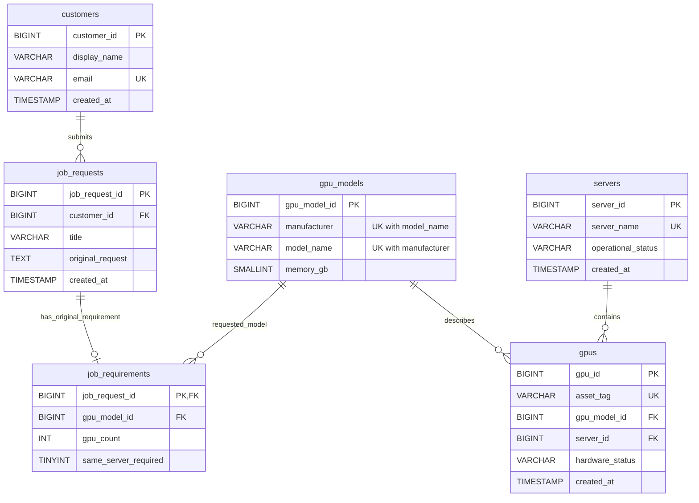

# v0.1 ERD 및 데이터 사전

MySQL 8.0.16 이상, InnoDB, `utf8mb4`를 사용한다. 모든 컬럼은 `NOT NULL`이다.
시간은 연결 세션을 UTC로 설정해 저장·조회한다. SQL 명세는 [schema.sql](schema.sql), 가상 데이터는 [seed.sql](seed.sql)에 있다.

## 키와 관계

- **Primary Key(PK)**: 행을 유일하게 식별한다. 중복과 NULL을 허용하지 않는다. `job_requirements`를 제외한 각 테이블은 `BIGINT UNSIGNED AUTO_INCREMENT` 식별자를 사용한다.
- **Foreign Key(FK)**: 부모 테이블의 존재하는 PK만 참조한다. 모든 FK는 `ON UPDATE RESTRICT ON DELETE RESTRICT`로 참조 중인 부모의 삭제·키 변경을 막는다. 연쇄 삭제는 사용하지 않는다.
- **1:N 관계**: 고객 한 명은 작업 여러 건을 요청할 수 있다. 서버 하나는 GPU 여러 개를 가지며, GPU 모델 하나는 여러 실제 GPU와 여러 작업 요구조건에서 참조된다. 자식 행은 반드시 부모 한 행을 참조하지만 부모에게 자식이 없을 수 있다. Mermaid의 `||--o{`로 표현한다.
- **1:1 관계**: 작업 한 건에 원본 요구조건은 최대 한 행이다. `job_requirements.job_request_id`가 PK이자 FK인 공유 기본 키 구조로 중복 요구조건과 고아 요구조건을 방지한다.
- DB 제약만으로는 부모 요청에 자식 요구조건이 반드시 존재함을 보장하지 못한다. 실제 DB 관계는 **1:0..1**이므로 `||--o|`로 표시했다. 업무상 정확히 1:1을 보장하는 요청·요구조건의 동일 트랜잭션 저장은 후속 서비스에서 구현한다. seed는 모든 요청에 요구조건을 넣는다.

## customers — 가상 고객

| 컬럼 | SQL 타입 | 역할 및 제약 |
| --- | --- | --- |
| customer_id | BIGINT UNSIGNED | PK, 자동 증가 |
| display_name | VARCHAR(100) | 표시 이름, 공백 문자열 금지 |
| email | VARCHAR(254) | 고객 식별용 연락 이메일, UNIQUE, 공백 문자열 금지; 이메일 형식 검증은 후속 입력 계층 책임 |
| created_at | TIMESTAMP | 생성 시점, 기본값 CURRENT_TIMESTAMP |

## gpu_models — 모델 공통 정보

| 컬럼 | SQL 타입 | 역할 및 제약 |
| --- | --- | --- |
| gpu_model_id | BIGINT UNSIGNED | PK, 자동 증가 |
| manufacturer | VARCHAR(50) | 제조사, 공백 문자열 금지 |
| model_name | VARCHAR(100) | 메모리·폼팩터 변형까지 구분하는 모델명, 공백 문자열 금지 |
| memory_gb | SMALLINT UNSIGNED | 모델의 메모리 용량, CHECK > 0 |

`(manufacturer, model_name)`에 복합 UNIQUE를 둔다. 예시는 H100-SXM-80GB와 A100-SXM-80GB이며 성능 예측을 위한 벤치마크 값은 저장하지 않는다.

## servers — GPU 소속 서버

| 컬럼 | SQL 타입 | 역할 및 제약 |
| --- | --- | --- |
| server_id | BIGINT UNSIGNED | PK, 자동 증가 |
| server_name | VARCHAR(100) | 운영용 서버 이름, UNIQUE, 공백 문자열 금지 |
| operational_status | VARCHAR(16) | ONLINE / MAINTENANCE / OFFLINE, 기본 ONLINE, CHECK |
| created_at | TIMESTAMP | 등록 시점, 기본값 CURRENT_TIMESTAMP |

## gpus — 개별 GPU 장비

| 컬럼 | SQL 타입 | 역할 및 제약 |
| --- | --- | --- |
| gpu_id | BIGINT UNSIGNED | PK, 자동 증가 |
| asset_tag | VARCHAR(64) | 개별 장비 관리번호, UNIQUE, 공백 문자열 금지 |
| gpu_model_id | BIGINT UNSIGNED | FK → gpu_models.gpu_model_id |
| server_id | BIGINT UNSIGNED | FK → servers.server_id |
| hardware_status | VARCHAR(16) | HEALTHY / FAULTY / MAINTENANCE, 기본 HEALTHY, CHECK |
| created_at | TIMESTAMP | 등록 시점, 기본값 CURRENT_TIMESTAMP |

GPU 모델의 공통 속성을 분리하면 수많은 GPU에 제조사·메모리를 반복 저장하지 않아도 된다. 개별 GPU에는 실제 소속과 장애 상태를 기록해 같은 모델의 정상·장애 장비를 구분한다.
`ALLOCATED`나 `BUSY`는 장비 상태가 아니다. 할당 여부는 후속 할당 테이블에서 관리하며 가용 수량 컬럼은 만들지 않는다.

## job_requests — 고객의 최초 요청

| 컬럼 | SQL 타입 | 역할 및 제약 |
| --- | --- | --- |
| job_request_id | BIGINT UNSIGNED | PK, 자동 증가; 향후 대안·할당의 연결 기준 |
| customer_id | BIGINT UNSIGNED | FK → customers.customer_id |
| title | VARCHAR(200) | 최초 작업 제목, 공백 문자열 금지 |
| original_request | TEXT | 최초 요청 원문, 공백 문자열 금지 |
| created_at | TIMESTAMP | 요청 등록 시점, 기본값 CURRENT_TIMESTAMP |

## job_requirements — 변경하지 않는 원본 기술 요구조건

| 컬럼 | SQL 타입 | 역할 및 제약 |
| --- | --- | --- |
| job_request_id | BIGINT UNSIGNED | PK 및 FK → job_requests.job_request_id |
| gpu_model_id | BIGINT UNSIGNED | FK → gpu_models.gpu_model_id |
| gpu_count | INT | 요청 GPU 수량, CHECK > 0; 최대 2,147,483,647 |
| same_server_required | TINYINT | 1: 동일 서버 필수, 0: 여러 서버 허용, CHECK IN (0,1) |

요청 원문은 고객 의사의 근거이며 기술 요구조건은 구조화된 매칭 입력이다. 이를 분리하면 원문을 보존하면서 모델·수량·배치를 정확히 조회할 수 있다. 원문과 구조화한 값의 일치 여부는 후속 요청 등록 서비스에서 확인한다.
v0.1은 작업당 GPU 모델 한 종류를 요구한다. 혼합 모델 요청은 범위 밖이며 미래에 별도 원본 요구조건 항목 구조가 필요하다.

## 원본 보존과 확장 경계

`job_requests`, `job_requirements`의 UPDATE와 DELETE는 각각 BEFORE 트리거에서 SQLSTATE `45000`으로 거부한다. 총 4개 트리거이며, 변화 없는 UPDATE도 거부한다.
일반 UPDATE/DELETE로 원본을 덮어쓸 수 없도록 한 정책이다. 관리자 DDL까지 방지하는 수단은 아니므로 실제 운영 앱 계정에는 DDL 권한을 부여하지 않아야 한다.
작업 상태는 원본 행에 추가·갱신하지 않고 후속 실행 상태 테이블로 분리한다. 대안은 `job_request_id`에 연결된 별도 테이블에 변경 조건을 저장하고, 할당은 `job_request_id`와 실제 `gpu_id` 및 적용 조건을 참조하도록 확장한다.

v0.1에는 할당 기록이 없으므로 정상 GPU 수를 **최종 가용 수량으로 취급하면 안 된다**. 현재 seed는 운영 상태와 배치 조건을 살펴볼 수 있는 데이터이며 실제 배정이나 예약을 수행하지 않는다.

## 인덱스 선택

- 각 PK와 UNIQUE는 InnoDB 인덱스로 구현된다. 동일 컬럼에 중복 인덱스를 추가하지 않는다.
- `gpus(gpu_model_id, hardware_status)`와 `gpus(server_id, hardware_status)`는 모델별·서버별 장비 조회와 FK 확인에 함께 사용한다.
- `job_requests(customer_id)`, `job_requirements(gpu_model_id)`는 FK 및 관련 작업 조회용이다. 공유 PK가 요청 FK 인덱스 역할을 겸한다.
- 작은 상태 컬럼 단독 인덱스나 아직 없는 조회 패턴을 위한 인덱스는 만들지 않는다.

## 가상 데이터 시나리오

- H100 서버 1: 정상 3개, 장애 1개. H100 서버 2: 정상 2개.
- A100 서버 1: 정상 2개, 점검 1개. 점검 중인 A100 서버 2: 정상 장비 1개.
- 원본 요청 5건: H100 2개 동일 서버, H100 4개 분산 허용, H100 4개 동일 서버, A100 1개, A100 3개 분산 허용.
- H100 정상 장비 합계는 5개지만 어느 서버에도 정상 4개가 없어 동일 서버 4개 조건을 충족하지 못한다. 점검 서버의 정상 장비도 운영 가능한 자원으로 세지 않는다.

## MySQL 근거 문서

- [CHECK 제약](https://dev.mysql.com/doc/refman/8.0/en/create-table-check-constraints.html): MySQL 8.0.16부터 CHECK를 실제 강제한다.
- [트리거 문법](https://dev.mysql.com/doc/refman/8.0/en/trigger-syntax.html): 행 변경 전 트리거로 원본 변경을 거부한다.
- [암묵적 커밋](https://dev.mysql.com/doc/refman/8.0/en/implicit-commit.html): 일반 CREATE TABLE 등 DDL은 전체 스크립트 롤백이 보장되지 않는다.
