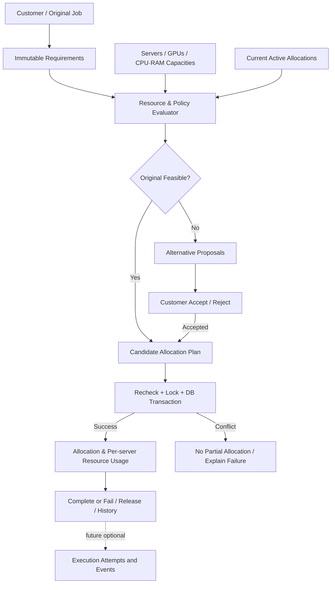

# AIDC Workload Matcher — 프로젝트 마스터 설계·개발 로드맵

> **문서 상태: 상위 개발 방향 승인(2026-11-11), 마일스톤별 작업 승인 전.** 이 문서를 GitHub에 반영하는 승인은 문서 변경에 한정된다. 코드·DB·마이그레이션·후속 Commit·Push는 매 작업의 구체적 별도 승인이 필요하며, '목표/후속'은 구현 완료를 뜻하지 않는다.
>
> 프로젝트: `hahyeong12/AIDC-Workload-Matcher` (DB 텀프로젝트). OSS `AIDC-Simulator`와 별개.
> v0.4-2 기능 구현 기준 커밋: `ca68895db1eaa347778ea27de74a08b440f7af32` (역사적 기준선). 문서·환경 인계 커밋은 이후 추가됐다. **최신 Git HEAD는 매 시작 시 원격·로컬을 직접 확인**하며 여기 적힌 SHA를 최신이라고 가정하지 않는다.

## 1. 교수님 평가 기준과 프로젝트의 지향점

- 과제: 데이터베이스를 활용한 서비스. GUI/CLI, DBMS, 프로그래밍 언어·장비 선택 자체는 핵심 배점 대상이 아니다.
- 제출물: 6쪽 보고서에 프로젝트 목적, DB 스키마·E-R 모델, DB와 상호작용하는 구현, 재현 가능한 실험과 평가, 한계점을 기술한다.
- 목표: *복잡한 자원 제약과 고객 동의가 있는 환경에서 정확하고 설명 가능한 AIDC 작업 배정*을 DB 설계·제약·트랜잭션으로 구현하고 검증한다.
- 핵심 주장은 '현업 전체를 구현'이 아니라 **제한된 물리 자원의 다중 고객 공유, 원본 보존, 동의, 동시성, 복합 자원 무결성을 다루는 재현 가능한 관계형 DB 설계**이다.
- 테이블 개수, 테스트 개수, UI 화려함 그 자체를 고득점 근거로 주장하지 않는다. **왜 이 관계가 필요한지 / 어떤 모순을 방지하는지 / 어떻게 평가했는지**를 증명한다.

## 2. 변경 불가 원칙(이미 합의된 정책)

1. 고객의 원문과 원본 기술 요구조건은 사후에 덮어쓰거나 삭제하지 않는다. 기존 `job_requests`, `job_requirements`의 보호 트리거 유지.
2. 실행 조건 변경은 별도 Proposal로 제시하고, 고객의 명시적 동의가 필요하다. 고객을 대신해 무단 수정하지 않는다.
3. **B안:** Proposal 생성·열람·수락 과정에서 GPU/CPU/RAM을 예약하거나 홀드하지 않는다. 수락은 실행 보장이 아니다.
4. 실제 배정 시 현재 장비·할당·용량을 **다시 조회하여 잠금과 트랜잭션**으로 자원을 함께 확정한다. 하나라도 부족하면 전부 롤백한다.
5. 하드웨어 상태(`ONLINE`, `HEALTHY` 등), 점유 상태, 의사결정 상태, 실제 실행 상태는 서로 다른 개념이다.
6. 요청·동의·배정·반환 근거와 과거 이력은 추적 가능해야 한다. 중복 재요청과 상태 충돌을 명시적으로 다룬다.
7. 실제 GPU 학습, 인증·권한 시스템, 과금, 작업 시간 예측, 자동 자연어 이해, 운영 환경 배포는 **이번 학부 텀프로젝트의 필수 범위가 아니다.** 구현하지 않은 것을 구현했다고 소개하지 않는다.
8. 개발 DB/테스트 DB/시연 DB/벤치마크 DB를 구분한다. 기기별 마지막 실측·보고·미확인 상태는 [환경 전환 루틴](ENVIRONMENT_HANDOFF.md)에 모아 기록하고 시작마다 재검증한다. 노트북 시연 DB의 M0-A 구성은 완료됐으며, 데스크톱 시연 DB와 벤치마크 DB는 구성 확인 전이다. DB 적용·데이터 변경·대량 주입·백업/복구는 변경 대상과 결과를 사전 설명하고 별도 승인받는다.
9. 기존 11개 테이블의 구조·이력·원본 보호를 보존하고 추가형 마이그레이션을 우선한다. 기존 테이블의 ALTER·FK/UNIQUE 강화는 호환성 검토 및 **별도 명시적 승인** 대상으로 한다.

## 3. 2026-11-11 확인된 기준선(v0.4-2)

**기존에 구현됨**
- 6개 기본 테이블 + `allocations`, `allocation_gpus`, `job_proposals`, `proposal_responses`, `allocation_bases` = 최대 11개 테이블.
- 원본 보호 트리거 4개, PK/FK/UNIQUE/CHECK, 생성 칼럼을 활용한 일부 활성 배정 충돌 방지.
- 모델/서버/GPU 상태 매칭, 동일 서버 필수·분산 허용, 현재 점유 제외, 원본/대안 배정, 원자적 반환, 제안·수락·거절·이력.
- 신규 Job 등록·조회와 Flask 로컬 UI.
- 저장소 검증 기록의 전체 599 passed(이 문서 작성 시 재실행하지 않음; 로컬 382, 실제 MySQL 전용 217로 보고됨).

**현재 한계 / 구분**
- 개발 DB: 8개 테이블·트리거 4개(003·004 미적용); 테스트 DB: 11개·트리거 4개. 개발 DB를 연결한 웹은 의도적으로 쓰기 차단.
- 실제 원본 기술조건은 Job당 GPU 모델 하나·수량·동일 서버 여부뿐. CPU/RAM/랙/작업시간/우선순위/미래예약 미지원.
- 대안은 동일 GPU 모델 안에서 분산 허용·수량 축소만 다룸. 성능·학습 품질 보장 금지.
- `lock_inventory`는 동일 GPU 모델 행과 해당 모델의 서버/전체 GPU 행을 잠금: 정확성 우선 구조이며 대규모 처리/동시성 비용의 실측 필요.
- 업무 서비스에서 검사하는 일부 제안-응답-배정 근거 일치는 DB의 외래 키만으로 완전히 강제되지 않음. 스키마와 검증 수준의 차이를 명시.
- 배정 기록의 성공은 실제 학습 프로세스 시작의 성공을 뜻하지 않음.

참고할 현행 문서: `docs/requirements.md`, `docs/architecture.md`, `docs/decisions.md`, `database/erd.md`, `docs/v0.4-2-validation.md`, `database/migrations/README.md`.

## 4. 목표 구조 — '전체 뼈대 → 수직 실행 → 상세 보강'

가장 중요한 원칙은 **판단(후보 계획 생성)** 과 **확정(잠금 + 재검증 + 원자적 저장)** 을 분리하는 것이다. Python 서비스는 판단 알고리즘을, MySQL은 영속 상태·관계·트랜잭션을 담당한다.

### 4-A. 최소 필수 확장: CPU·RAM을 GPU와 함께 배정

기존 11개 테이블을 보존한 상태로, 구체적인 테이블명·키·제약은 설계 리뷰 후 확정한다. 아래는 제안 구조이며 **DDL이 아니다**.

| 제안 테이블 | 목적 및 주요 관계 | 설계상 주의사항 |
|---|---|---|
| `server_resource_capacities` | `server_id` 1:1, 서버별 CPU 코어·RAM 총용량 | 원본 하드웨어 총용량과 현재 가용량 구분, 음수·0의 유효 범위 결정 |
| `job_compute_requirements` | `job_request_id` 0..1(확장된 신규 Job은 필수), **GPU 1개당 필요한 CPU 코어·RAM GB** | 요구조건 단위 의미를 고정하고 원본 보호; 레거시 Job 미기입을 0 요구량으로 임의 간주하지 않음 |
| `allocation_server_resources` | `(allocation_id, server_id)` 별 배정한 CPU 코어·RAM GB | 개별 GPU의 서버 배정과 수량 관계 확인, ACTIVE 배정 합계가 서버 총용량을 초과하지 않게 잠금·재검증 |

**자원 수요 의미(먼저 확정할 제안):** GPU 4개, GPU당 CPU 8코어·RAM 32GB이면 총 CPU 32코어·RAM 128GB. 3+1 GPU를 서로 다른 서버에 배치한다면 각 서버는 24/96, 8/32를 각각 확보해야 한다. CPU/RAM의 전체 합계만 확인하고 서버별 부족을 놓치지 않는다.

- 한 작업에 여러 GPU 모델 혼합, CPU와 RAM을 GPU와 독립적으로 자유 분산하는 정책, 정밀 네트워크 대역폭 보증은 이번 확장의 필수 조건이 아니다.
- 기존 GPU-only Job과 신규 multi-resource Job의 동작을 구분한다. 기존 행·원문·트리거를 임의 변경하지 않으며 **레거시 정책을 문서화하고 전용 테스트로 고정**한다.
- 신규 Job은 원본+원본 GPU 조건+확장 CPU/RAM 조건을 **같은 트랜잭션**에서 등록해야 한다.
- CPU/RAM 점유량은 종료된 배정을 제외해 계산한다. 종료/반환도 GPU와 함께 **동일 트랜잭션**으로 처리한다.
- `CHECK`/일반 `FK`만으로 '다른 행의 합계가 총용량 이하'임을 자동으로 검증할 수는 없다. 서버 행 잠금 + 사용량 재조회 + 원자적 쓰기를 기본으로 하되 DB 수준의 방어 범위를 별도 설계 리뷰에서 정한다.
- 기본 구현에서 높은 정확성을 택하고 성능 실험 뒤에만 잠금 세분화를 논의한다.

### 4-A-1. 복합 자원 확장 전 필수 설계 결정(M1 검토 대상)

**A. 레거시 GPU-only Job:** 기존 Job 001~005와 과거 할당 기록은 수정하지 않는다. CPU/RAM 요구조건이 누락된 기존 Job은 자원 사용량이 0임을 뜻하지 않는다. 기존 GPU-only 기능은 유지하되, CPU/RAM 사용량을 알 수 없는 기존 활성 배정과 신규 복합 배정이 같은 서버를 공유하는 것은 **초기에는 보수적으로 제한**하는 방향을 추천한다. 혼용 금지의 구체적 검사 범위와 과거 활성 배정 처리 방식은 M1에서 승인받는다.

**B. CPU·RAM 단위:** GPU 1개당 CPU 코어와 RAM 수요 모델을 우선 제안한다. CPU의 물리/논리 코어 기준, RAM의 GB/GiB 기준, 최소·0 허용 범위, 컬럼명·정수 단위는 **아직 미확정**이다. 예시 계산은 이 선택이 확정됐다고 주장하지 않는다.

**C. 새로운 원본 보호:** `job_compute_requirements`의 CPU/RAM 원본에도 UPDATE/DELETE 보호가 필요하다. 기존 4개 트리거는 그대로 유지하며 새 테이블 전용 트리거 2개 등의 보강을 검토한다. 신규 복합 Job 등록은 기존 원문·GPU 조건·CPU/RAM 조건의 **3개 INSERT를 같은 트랜잭션**에서 저장한다. 0..1 관계만으로 신규 Job에 CPU/RAM 행이 필수임을 DB FK가 자동 보장하지 않으므로 서비스·검증 책임을 명시한다.

**D. 대안의 자원 의미:** 최소 확장에서는 GPU당 CPU/RAM 요구량을 바꾸지 않고 GPU 수량 축소·서버 분산 허용으로 달라진 **총량과 서버별 수요**를 표시한다. GPU당 CPU/RAM 자체의 완화는 새로운 고객 동의 정책을 설계하기 전까지 비목표다.

**E. 공유 서버의 동시성:** 다른 GPU 모델의 작업도 같은 서버의 CPU/RAM을 사용한다. GPU 모델 잠금만으로 서버 용량 경쟁을 막는다고 주장하지 않는다. 서버 행을 일관된 순서로 잠근 뒤 ACTIVE 사용량을 재조회하고, 용량 부족이면 GPU·CPU·RAM·할당 근거를 함께 롤백한다. 장비·용량 변경 경로도 같은 잠금 규약을 따라야 한다. 실제 GPU 배치 서버와 CPU/RAM 배정 서버의 관계 검증이 필요하다.

**F. 보장 경계와 스키마 버전:** PK/FK/CHECK의 행·참조 제약과 서버별 활성 용량 **합계**, 고객 응답의 정확한 일치처럼 서비스 잠금으로 강제하는 규칙을 구별한다. 직접 SQL까지 모든 업무 불변식이 보장된다고 주장하지 않는다. 현재 스키마 검사기·Flask 쓰기 게이트는 정상 11개 스키마를 인식하므로, 14개 목표를 구현할 때 **명시적 버전 인식 확장**과 회귀 테스트를 포함한다.

### 4-B. 선택적 확장: 실패·재시도 이력

`execution_attempts`(개별 실행 시도 ID, 할당 FK, 시작/종료/실패 사유, 시도 순서)와 필요 시 `execution_events`를 정의할 수 있다. 실제 GPU 연산은 하지 않고 **모의 실행**에서 '배정됨 ≠ 실제 시작됨'을 구분한다. 개발 여력과 성능 평가 진행 정도를 본 뒤 채택 여부 결정. **필수 확장으로 자동 승격 금지.**

### 4-C. 이번 제출의 명시적 비목표

- 실제 GPU·CUDA 제어, 클러스터 설치, 외부 클라우드 API, 고급 신경망 실행시간 예측
- 스케줄러 산업 제품의 전체 재현(선점, 정책 최적화, 랙·망 토폴로지, 멀티 GPU 모델, 과금)
- 자연어로 받은 임의 조건의 자동 추론·고객 동의 생략
- 실제 다중 사용자 인증·인터넷 배포(로컬 시연용 고객 선택은 인증이 아님)

## 5. 버전별 개발 계획: 각 단계 승인 후 진행

### M0 — 기준선 봉인 및 시연 경로 완성(우선)

- **2026-11-18 상태:** 노트북 M0-A 시연 DB 구성·seed 입력 완료, 백업 존재·해시 검증 성공. 실제 복원 검증과 M0-B 영구 COMMIT 시연은 미완료이며 M0 전체 완료로 보지 않는다. 실측 근거는 [환경 전환 기록](ENVIRONMENT_HANDOFF.md), 후속 실행 순서·중단 조건은 [M0-B 시연 검증 계획](m0-validation.md)을 따른다.
- 최신 HEAD, DB별 스키마/트리거, 테스트 결과와 코드 변경분 확인.
- **개발 DB를 자동 마이그레이션하지 않는다.** 백업·복구 계획과 대상 DB를 검토한 뒤 별도 시연 DB에 정상 11개 스키마를 재현하는 방법을 합의한다. 기존 003·004 마이그레이션의 테스트 전용 보호를 시연 DB 구성에 편법으로 우회하지 않는다.
- 시연에서 신규 Job → 매칭 → 대안 생성 → 고객 응답 → 배정 → 완료/실패 → 이력 조회까지 실제 영구 COMMIT으로 통과하는지 검증한다.
- 원본 보존·동의 없는 변경 거부·제안 단계 무점유·수락 후 부족 자원 재검증을 시연한다.
- **완료 조건:** 별도 시연 DB에서 신규 Job의 실제 영구 COMMIT·다른 연결의 조회, 매칭·대안·동의·배정·반환·이력 확인, DB 변경 안전성 기록. 기존 자동 테스트 DB에 시연용 영구 원본을 남기지 않는다.

### M1 — 최종 목표 ERD/정의 합의(코딩 전 설계 심사)

- 기존 11개 테이블과 신규 3개 테이블의 관계, 1:1/1:N, 각 키·제약·인덱스·상태 정의를 제시한다.
- `cpu_cores_per_gpu`/`memory_gb_per_gpu`가 정확히 무엇을 뜻하는지 예시로 정의하고 분산 시 요구량을 검증한다.
- 레거시 Job 처리, 원본 보호, 고객 동의와 변경 조건, 격리 수준/잠금 순서, 실패·재시도/트랜잭션 경계를 명시한다.
- DB가 직접 강제하는 불변식, 서비스가 잠금과 코드로 강제하는 불변식, 시뮬레이션상 가정을 구별한다.
- **완료 조건:** 텍스트 ERD·관계표·상태 전이·실패 사례·수용 테스트 계획을 검토하고 사용자 승인.

### M2 — 확장 DB '뼈대' 및 최소 수직 흐름

- 기존 정의/이력 보존을 우선하는 **추가형 마이그레이션**을 전용 테스트 DB에서만 검증한다.
- 신규 multi-resource Job 등록 → 조건 검증 → 사용 가능 여부 → 원본 배정 → 반환·이력이 끝까지 동작하도록 최소 경로를 만든다.
- 레거시 GPU-only 동작이 바뀌지 않았음을 전체 회귀 테스트로 증명한다.
- **완료 조건:** 전용 테스트 DB에서 새 제약·회귀 검증, 별도 승인된 시연 DB에서 복합 자원 한 건의 영구 배정·반환·이력 확인, 기존 테스트 통과. 신규 스키마 버전을 검사기·Flask가 명시적으로 인식해야 한다.

### M3 — 대안·동의·경합·복구 완성

- GPU 수량 축소·분산 대안에 CPU/RAM 수요를 함께 반영해 제안 조건을 재평가한다.
- 수락은 무예약, 확정 직전 GPU·CPU·RAM을 함께 잠그고 재검증하며 하나라도 부족하면 전부 롤백한다.
- 중복·동시성·실패 주입·잘못된 직접 SQL에 대한 허용/거부 결과를 제약별로 증명한다.
- 가능하면 기존 `allocation_bases`의 응답-제안-작업-고객 일관성을 **DB 복합 FK/UNIQUE로 강화할 수 있는 범위**를 안전하게 설계한다. 그러나 기존 테이블 ALTER가 필요하다면 '11개 구조 보존'의 예외로 구분하고, 호환성·백업·실행 위험에 관한 별도 사용자 승인 없이 시행하지 않는다.
- **완료 조건:** 고객 응답·대안 배정·완료/실패의 전체 경로와 오류 사례 통과.

### M4 — 성능 평가와 개선(교수님 평가 핵심)

- 작은/중간/큰 규모의 **별도 벤치마크 DB**에 현실적인 분포의 가상 서버·GPU·Job·활성 할당을 생성한다. 기존 개발·테스트 DB 오염 금지.
- 비교 대상: (1) 인덱스별 조회 계획 `EXPLAIN ANALYZE`, (2) 후보 선정/배정의 실행시간 p50·p95, (3) 같은 모델/서로 다른 모델 동시 배정 시 처리량·대기시간, (4) 오류·경합에서 무결성 유지.
- 기존 모델 단위 넓은 잠금이 병목인지 실측하고, 락 범위 세분화/쿼리 수 감소 같은 개선은 **기준선과 비교 후** 채택한다.
- 결과가 개선되지 않으면 그 사실도 명시한다. 허구의 성능 개선율 금지.
- **완료 조건:** 반복 재현 가능한 생성기/명령/환경표/실측 결과와 설명.

### M5 — 제출용 설명·재현성·최종 시연

- 6쪽 구성 예시: ① Abstract/Introduction ② Background & Problem ③ ERD·핵심 관계/무결성 ④ 트랜잭션/구현 흐름 ⑤ Evaluation(실측 성능·동시성·실패) ⑥ Conclusion/한계/재현 방법.
- 주요 주장에 대응하는 SQL, ERD, 전후 상태, 실제 측정 근거를 연결한다.
- 공개 가능한 가상 데이터·환경 준비·시연 스크립트를 검증한다. 실제 서비스 수준의 인증/예측/배포를 주장하지 않는다.

## 6. 반드시 통과해야 할 핵심 수용 시나리오

1. GPU는 충분하지만 서버별 CPU 또는 RAM이 부족 → 전체 배정 실패, 모든 자원 미점유.
2. GPU·CPU·RAM을 모두 만족 → 정확한 서버/GPU/CPU/RAM 수요를 하나의 배정으로 기록.
3. 동일 서버 필수와 분산 허용의 차이를 재현. 각 서버별 CPU/RAM 수용량도 확인.
4. 대안 생성·조회·수락 전후 활성 점유량 불변. 원본 요청/요구조건 불변.
5. 수락 이후 다른 고객이 자원을 먼저 점유 → 확정 직전 재검증, 부분 배정 없이 실패. Job당 수락은 1회이므로 같은 대안 재시도·원본 배정·새 Job 등록 중 선택한다(같은 Job 재협의는 미지원, [F1 검증 기록](f1-allocation-history-validation.md) 참고).
6. 같은 GPU 또는 서버 용량을 서로 다른 작업이 동시에 요구 → 초과 배정 방지.
7. 트랜잭션 중간 실패 → GPU·CPU·RAM·배정 근거의 부분 기록 0.
8. 정상 종료/실행 실패 → 모든 점유 해제, 과거 요청·동의·배정 이력 유지.
9. 레거시 GPU-only Job의 기존 기능과 테스트가 계속 통과.
10. 직접 SQL로 조작했을 때 DB 수준에서 강제 가능한 규칙과 서비스 전용 규칙을 별도로 기술.

## 7. AI 협업의 역할과 승인 게이트

- GPT: 요구사항·업무 상황 설명, 설계 대안/트레이드오프 분석, ERD·검증 기준·최종 보고서 리뷰.
- Codex: 승인된 작은 단계의 코드·테스트·문서 구현. 범위 밖 수정 금지.
- Claude Code: 독립 코드·DB 무결성·경합·마이그레이션 위험 리뷰 및 보완 제안. 리뷰 결과를 근거로 개선 여부 결정.
- 사용자: 각 단계의 모델·변경 범위·DB 적용·커밋/푸시 승인 및 실제 시연 확인. **상위 문서 반영 승인은 후속 구현·DB 쓰기 승인이 아니다.**
- 서로 다른 에이전트가 같은 DB·브랜치를 동시에 변경하지 않는다. **하나의 작업 기준 커밋 → 설계안 → 승인 → 구현 → 독립 리뷰 → 테스트/DB 감사 → 커밋/푸시** 순으로 진행한다.
- 보고 또는 구현을 완료했다고 주장할 때에는 실제 실행 명령, 테스트 수, DB 대상, 변경 파일, 남은 한계가 필요하다.
- 서버의 어떤 DB에 적용하는지 불명확하면 절대로 쓰지 않는다. 강제 Push/Reset/Rebase, 원본 삭제, 테스트/개발 DB 혼동, 임의 마이그레이션/seed 재삽입 금지.

## 8. 최초 합의가 필요한 설계 결정(열린 항목)

- D1. 이번 제출의 확정 범위가 'GPU+CPU+RAM 복합 자원 배정'인가? 실행 시도/장애 이력은 선택 확장으로 남길 것인가?
- D2. CPU/RAM 요구량의 단위는 'GPU당'인가, 작업 총량인가? 이 문서는 **GPU당 자원량**을 추천한다.
- D3. 레거시 Job의 추가 자원조건 부재를 어떤 상태로 표시할 것인가? 무단 0 보정 금지.
- D4. DB 제약과 서비스 검증 사이의 책임 경계를 어떻게 문서화하고 보강할 것인가?
- D5. 평가에 사용할 데이터 크기와 배정·조회 실험 대상은 무엇인가?
- D6. 기존 GPU-only 활성 배정과 새 복합 배정이 같은 서버를 공유하는 정책과 그 방어 범위는?
- D7. CPU 물리/논리 코어·GB/GiB 단위, 신규 원본 트리거와 14개 스키마 버전 인식, 시연/벤치마크 DB 별도 승인 방식은?

> **다음 행동:** 노트북 M0-A 이후의 백업 복원 검증·M0-B 영구 COMMIT 시연과 M1의 확장 모델 합의에 대한 **별도 작업 승인**을 먼저 받는다. M1의 ERD가 확정되기 전 새로운 DDL을 생성하거나 실제 DB에 적용하지 않는다. 상위 방향은 승인되었지만 후속 구현·DB 변경은 미승인이다.
